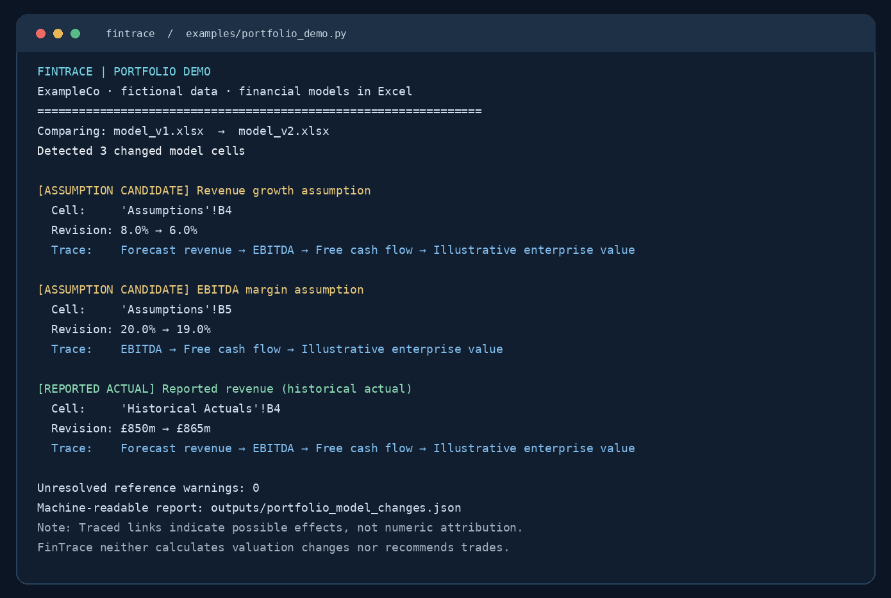

# FinTrace portfolio demo: a financial model revision

**Purpose:** show how FinTrace distinguishes *new reported information* from *changes in analyst judgement*, and records where those changed inputs flow through an existing Excel model.

This example uses **ExampleCo, a fictional company**. All data, assumptions and names are synthetic. This is a simplified teaching model, not investment research or a DCF valuation.

## Open the actual Excel files

The repository contains two valid `.xlsx` workbooks, both with three sheets:

- [`model_v1.xlsx`](../examples/sample_models/model_v1.xlsx): original estimates
- [`model_v2.xlsx`](../examples/sample_models/model_v2.xlsx): revised estimates

The sheets are **Historical Actuals** (reported revenue), **Assumptions** (growth, EBITDA margin, cash conversion, illustrative valuation multiple), and **Forecast** (formula-linked outputs).

| Input | Model v1 | Model v2 | Why it differs |
| --- | ---: | ---: | --- |
| FY2025 reported revenue | £850m | £865m | Revised historical actual |
| FY2026 revenue growth | 8.0% | 6.0% | Analyst assumption revision |
| EBITDA margin | 20.0% | 19.0% | Analyst assumption revision |
| Cash conversion rate | 68.0% | 68.0% | Unchanged simplification |
| Illustrative FCF multiple | 10.0x | 10.0x | Unchanged simplification |

The Excel forecast contains straightforward, inspectable formulas. For example:

```excel
='Historical Actuals'!B4*(1+'Assumptions'!B4)
```

This formula explicitly connects historical revenue and the analyst's growth assumption to forecast revenue.

## Reproduce the result

From the repo root:

```bash
python -m pip install -e ".[dev,excel]"
python examples/portfolio_demo.py
```

For the lower-level CLI and a JSON export:

```bash
fintrace compare-excel examples/sample_models/model_v1.xlsx examples/sample_models/model_v2.xlsx --json-out outputs/portfolio_model_changes.json
```

The script and command report the changed cells, their review classifications and downstream candidate outputs. The demonstration is deterministic, and the workbooks are committed so reviewers can open the actual inputs.



## Financial interpretation

The reported-revenue update and the revenue-growth assumption both affect projected revenue, but they represent different kinds of information:

- A changed **historical actual** is a change to a reported input. It should be checked against the source and its restatement/revision context.
- A changed **assumption** is a judgement about the future. It should be linked to the analyst's rationale and evidence.

FinTrace detects these *candidate* categories and their formula dependencies. They remain subject to human review. The engine does **not** claim to know why the analyst changed a cell, calculate spreadsheet formulas, quantify the monetary contribution of each driver or recommend an investment.

## Why this matters

Ordinary file comparison shows which cells differ. FinTrace is designed to add financial context: *is this a revised historical number, a changed assumption, or a formula change — and which material outputs depend on it?* The longer-term goal is to connect those answers to documentary evidence, assumption histories and valuation attribution while keeping analysts responsible for their conclusions.
